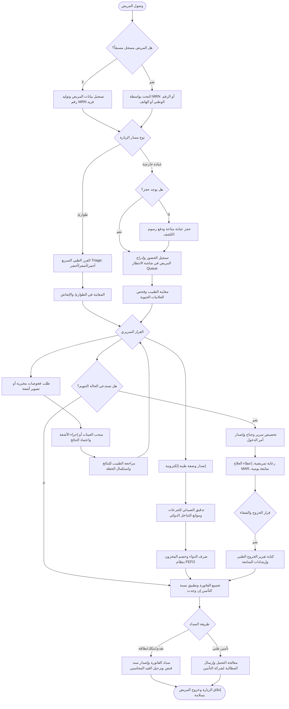

# وثيقة التحليل والتصميم الفني والمعماري الشامل (PHASE 0)
## مشروع نظام إدارة المستشفيات المتكامل (HOSPITAL HMS)
**البيئة والمنشأة المستهدفة:** مستشفى عام متوسط الحجم في السودان (50 - 200 سرير)  
**العملة الأساسية:** الجنيه السوداني (SDG)  
**اللغات المدعومة:** ثنائي اللغة (العربية RTL / الإنجليزية LTR)  
**المعمارية التقنية:** Native PHP 8.4 Custom MVC (بدون أطر عمل خارجية) | MySQL 8 InnoDB | Bootstrap 5 + Vanilla JS + Fetch API

---

## 1. وثيقة تحليل المتطلبات الوظيفية وغير الوظيفية (Requirements Specification)

### 1.1 المتطلبات الوظيفية (Functional Requirements)
النظام يغطي 28 وحدة وظيفية متكاملة مقسمة إلى 6 قطاعات حيوية:

1. **القطاع الإداري والاستقبال (Administrative & Front Desk):**
   - **الاستقبال والتسجيل:** فتح ملف مريض جديد وتوليد الرقم الطبي الموحد (MRN) بصيغة تسلسلية مشفرة محلياً تمنع التكرار (`SD-HOSP-YYYY-XXXXXX`).
   - **المواعيد والانتظار:** جدولة مواعيد العيادات، تنظيم شاشات الطوابير (Queue Display) التفاعلية حسب الأقسام والتخصصات.
   - **إدارة الأسِرّة والغرف:** خريطة حية (Interactive Bed Matrix) تُظهر حالة الأسِرّة لحظياً (شاغر، مشغول، قيد التعقيم، محجوز).

2. **القطاع السريري والطبي (Clinical & Medical Care):**
   - **السجل الطبي الإلكتروني (EMR/EHR):** أرشفة السيرة المرضية، الأمراض المزمنة، الحساسيات الدوائية والغذائية مع تنبيهات ملونة صارمة.
   - **العيادات الخارجية (OPD):** واجهة الطبيب للكشف، فحص العلامات الحيوية، تسجيل التشخيصات وفق الترميز العالمي (ICD-10)، وإصدار الوصفات والطلبات الطبية.
   - **الطوارئ والفرز (ER & Triage):** تصنيف الحالات فور وصولها بنظام الألوان الدولي (MTS/ESI: أحمر - حرج جداً، أصفر - عاجل، أخضر - روتيني)، وسرعة فتح زيارة الطوارئ وتوجيه الحالات لإنعاش القلب أو الملاحظة.
   - **التنويم الداخلي (IPD & Nursing):** محطات التمريض الرقمية، مخططات الرعاية التمريضية، تسجيل المؤشرات الحيوية الدورية، وسجل إعطاء الدواء التمريضي (MAR - Medication Administration Record).
   - **العمليات والعناية المركزة (OR & ICU):** جدولة غرف العمليات، توثيق الطاقم الجراحي والتخدير، مراقبة مؤشرات الحالات الحرجة بالعناية المركزة لحظياً.

3. **الخدمات التشخيصية المساندة (Diagnostic Services):**
   - **المختبر الطبي (LIS):** إصدار باركود العينات، دورة حياة العينة (طلب -> جمع -> استلام -> تحليل -> اعتماد -> طباعة)، فحص القيم الحرجة (Panic/Critical Values) وإطلاق تنبيهات فورية للطبيب المعالج.
   - **الأشعة والتصوير الطبي (RIS):** تسجيل طلبات الأشعة، توثيق تقرير طبيب الأشعة، وإدارة مرفقات الصور الطبية وملفات DICOM عبر مسارات تخزين مؤمنة.

4. **القطاع الدوائي والمخزني (Pharmacy & Supply Chain):**
   - **الصيدلية:** استلام إلكتروني مباشر للوصفات الطبية، تدقيق الجرعات وموانع الاستعمال، آلية التحقق الثنائي (Double-Check Dispense)، والصرف المباشر مع خصم الأرصدة آلياً بنظام الأقدم انتهاءً يُصرف أولاً (FEFO).
   - **المستودعات والمشتريات:** إدارة المخازن المركزية والفرعية، تتبع أرقام التشغيلات (Batch Numbers)، وتنبيهات حد إعادة الطلب وقرب انتهاء الصلاحية، مع دورة أوامر الشراء (LPO) وفحص وتوريد البضائع (GRN).

5. **القطاع المالي والمحاسبي (Financial & Accounting):**
   - **الفوترة والتحصيل:** تسعير الخدمات التلقائي، إصدار فواتير نقدية/تأمينية، وإدارة جلسات الصناديق (Cashier Sessions) مع محاضر الجرد اليومي والتسليم.
   - **التأمين الطبي:** إدارة عقود شركات التأمين، شبكات التغطية، نسب التحمل (Co-pay)، إصدار طلبات الموافقة المسبقة (Prior Authorization)، ومطالبات التأمين المجمعة.
   - **المحاسبة العامة (Double-Entry General Ledger):** دليل حسابات شجري متوافق مع المعايير المحاسبية، قيود يومية آلية عند كل عملية صرف/فوترة/تحصيل، دفاتر الأستاذ، وموازين المراجعة والقوائم المالية الختامية.

6. **إدارة الموارد البشرية والنظام (HR & System Governance):**
   - شؤون الموظفين، المناوبات والورديات الطبية، تسجيل الحضور، والرواتب بالجنيه السوداني (SDG).
   - إدارة المستخدمين بنظام الصلاحيات الدقيق (RBAC)، وتوثيق كل نشاط عبر سجل التدقيق (Audit Trail) غير القابل للتعديل.

---

### 1.2 المتطلبات غير الوظيفية (Non-Functional Requirements)

1. **الأمان والخصوصية (Security & HIPAA Alignment):**
   - تشفير كلمات المرور باستخدام خوارزمية `Argon2id` أو `bcrypt` المقواة.
   - حماية كاملة ضد هجمات الويب الأساسية: CSRF عبر Secure Tokens مع كل طلب POST/PUT، وتشفير الجلسات وحمايتها بـ `HttpOnly`, `SameSite=Strict`, `Secure`.
   - منع هجمات حقن قواعد البيانات بنسبة 100% بالاعتماد التام على PDO Prepared Statements دون دمج نصوص الاستعلامات يدوياً.
   - منع XSS عبر التعقيم الصارم وتنظيف المخرجات باستخدام `htmlspecialchars(..., ENT_QUOTES, 'UTF-8')`.
   - حظر الوصول المباشر إلى الملفات المرفوعة (المرفقات، نتائج الفحوصات، تقارير الأشعة) بوضع مجلد `storage` خارج نطاق خادم الويب العام (`public_html`) وتمرير الملفات عبر Streaming Controller يتحقق من صلاحية المستخدم أولاً.

2. **الأداء والموثوقية (Performance & Reliability):**
   - سرعة استجابة صفحات النظام لا تتجاوز 250 ميلي ثانية داخل الشبكة المحلية للمستشفى.
   - معالجة العمليات المالية والسريرية الحساسة داخل **Transactions** ذرية (ACID Compliant) مع التراجع الكامل (Rollback) في حال وقوع أي خطأ برمجي أو شبكي لمنع تضارب البيانات.
   - استخدام الفهارس المركبة (Composite Indexes) على الحقول المستخدمة بكثرة في البحث والتقارير (مثل `mrn`, `national_id`, `created_at`, `status`).

3. **سهولة الاستخدام والتوافق البيئي (Usability & Localization):**
   - دعم كامل للغة العربية (RTL) واللغة الإنجليزية (LTR) مع تبديل لحظي وديناميكي للواجهة.
   - دعم المظهرين الفاتح والداكن (Light/Dark Mode) لتقليل إجهاد أعين الأطباء والتمريض أثناء المناوبات الليلية.
   - التصميم المعتمد على ألوان الهوية الطبية المحددة:
     - الأزرق الداكن: `#173B59` (Primary Brand & Sidebar)
     - الأخضر الطبي: `#16856D` (Success & Clinical Actions)
     - الخلفية الفاتحة: `#F3F6F9` (Content Background)
     - الرمادي المريح: `#DCE5EC` (Borders & Dividers)
     - لون التمييز والتحذير: `#D49A36` (Accents & Alerts)

4. **العملات والامتثال المالي السوداني:**
   - الحساب الدقيق لجميع المبالغ المالية بنوع `DECIMAL(15, 2)` بالجنيه السوداني (SDG) مع منع التقريب العشوائي.

---

## 2. خريطة الوحدات وعلاقاتها البينية (Module Architecture Map)

```mermaid
graph TD
    subgraph Core Administration
        ADM[Dashboard & Admin]
        SEC[Users & RBAC Security]
        AUD[Audit Logs & Settings]
        HR[HR & Payroll]
    end

    subgraph Front Desk & Patients
        REG[Patient Registration & MRN]
        APP[Appointments & Scheduling]
        QUE[Queue Management]
    end

    subgraph Clinical Core
        EMR[Electronic Medical Records]
        OPD[Outpatient Department]
        ER[Emergency & Triage]
        IPD[Inpatient & Admissions]
        BED[Bed Management Matrix]
        NUR[Nursing Station & MAR]
        SUR[Surgery & ICU]
    end

    subgraph Diagnostics & Supply
        LIS[Laboratory System]
        RIS[Radiology System]
        PHAR[Pharmacy Dispensing]
        INV[Warehouse & Inventory]
        PROC[Procurement & Suppliers]
    end

    subgraph Finance & Insurance
        BILL[Billing & Cashboxes]
        INS[Medical Insurance Claims]
        ACC[Double-Entry General Ledger]
    end

    %% Flow connections
    REG --> APP --> QUE --> OPD
    REG --> ER
    OPD --> EMR
    ER --> EMR
    EMR --> IPD
    IPD --> BED
    IPD --> NUR
    IPD --> SUR
    
    EMR -.->|Orders| LIS
    EMR -.->|Orders| RIS
    EMR -.->|Prescriptions| PHAR
    
    LIS -.->|Charge| BILL
    RIS -.->|Charge| BILL
    PHAR -.->|Charge| BILL
    OPD -.->|Charge| BILL
    IPD -.->|Charge| BILL
    
    PHAR --> INV
    INV --> PROC
    
    BILL --> INS
    BILL --> ACC
    PROC --> ACC
    HR --> ACC
    
    SEC -.->|Enforces| Core Administration
    SEC -.->|Enforces| Front Desk & Patients
    SEC -.->|Enforces| Clinical Core
    SEC -.->|Enforces| Diagnostics & Supply
    SEC -.->|Enforces| Finance & Insurance
    AUD -.->|Tracks All Changes| Core Administration
```

---

## 3. مسار العمل الشامل لدورة حياة المريض (Patient Lifecycle Workflow)



---

## 4. مخطط الكيانات والعلاقات العام (Comprehensive Database ERD)

```mermaid
erDiagram
    users ||--o{ audit_logs : generates
    users ||--o{ user_roles : has
    roles ||--o{ user_roles : assigned_to
    roles ||--o{ role_permissions : contains
    permissions ||--o{ role_permissions : belongs_to
    departments ||--o{ clinics : includes
    departments ||--o{ employees : employs
    employees ||--o{ doctors : is
    employees ||--o{ nurses : is
    
    patients ||--o{ patient_contacts : has
    patients ||--o{ patient_allergies : has
    patients ||--o{ patient_insurance : covers
    patients ||--o{ appointments : books
    patients ||--o{ visits : attends
    
    visits ||--o{ encounters : conducts
    encounters ||--o{ vital_signs : records
    encounters ||--o{ clinical_notes : contains
    encounters ||--o{ diagnoses : identifies
    encounters ||--o{ prescriptions : orders
    encounters ||--o{ medical_orders : requests
    
    prescriptions ||--o{ prescription_items : details
    prescription_items ||--o{ pharmacy_dispense_items : dispensed_in
    
    visits ||--o{ emergency_cases : routes_to
    emergency_cases ||--o{ triage_assessments : evaluates
    
    visits ||--o{ admissions : requires
    wards ||--o{ rooms : contains
    rooms ||--o{ beds : contains
    admissions ||--o{ bed_assignments : occupies
    beds ||--o{ bed_assignments : assigned_to
    admissions ||--o{ nursing_notes : receives
    admissions ||--o{ medication_administrations : administers
    admissions ||--o{ discharge_records : concludes
    
    medical_orders ||--o{ lab_orders : triggers
    lab_tests ||--o{ lab_orders : includes
    lab_orders ||--o{ lab_samples : collects
    lab_orders ||--o{ lab_results : yields
    
    medical_orders ||--o{ radiology_orders : triggers
    radiology_services ||--o{ radiology_orders : includes
    radiology_orders ||--o{ radiology_reports : reports
    
    medicines ||--o{ medicine_batches : has
    warehouses ||--o{ warehouse_items : stores
    medicine_batches ||--o{ warehouse_items : located_in
    
    visits ||--o{ invoices : bills
    invoices ||--o{ invoice_items : itemizes
    invoices ||--o{ payments : settles
    cashboxes ||--o{ cashbox_sessions : runs
    cashbox_sessions ||--o{ payments : receives
    
    invoices ||--o{ insurance_claims : files
    insurance_companies ||--o{ insurance_claims : billed_to
    
    journal_entries ||--o{ journal_details : balances
    accounts ||--o{ journal_details : debited_credited
```



---

## 5. قاموس البيانات الشامل (Enterprise Data Dictionary)

يغطي هذا القاموس جميع الجداول المعتمدة لقاعدة بيانات `hospital_hms` محددة الحقول والأنواع والقيود.

### المجموعة A: المستخدمون والأمان (Users & Security)

#### 1. جدول `users`
| الحقل | النوع | القيود | الوصف |
| :--- | :--- | :--- | :--- |
| `id` | BIGINT UNSIGNED | PK, AUTO_INCREMENT | المعرف الرقمي الفريد للمستخدم |
| `username` | VARCHAR(50) | UNIQUE, NOT NULL | اسم الدخول الفريد للنظام |
| `email` | VARCHAR(100) | UNIQUE, NOT NULL | البريد الإلكتروني المعتمد |
| `password_hash` | VARCHAR(255) | NOT NULL | رمز المرور المشفر (Argon2id/Bcrypt) |
| `employee_id` | BIGINT UNSIGNED | NULL, FK(`employees.id`) | ربط الحساب بسجل الموظف الفعلي |
| `user_type` | ENUM('staff','patient') | NOT NULL, DEFAULT 'staff' | تصنيف الحساب (موظف/مريض) |
| `is_active` | TINYINT(1) | NOT NULL, DEFAULT 1 | حالة الحساب (1: مفعل، 0: معطل) |
| `failed_logins` | TINYINT UNSIGNED | NOT NULL, DEFAULT 0 | عداد المحاولات الفاشلة لمنع القوة الغاشمة |
| `locked_until` | DATETIME | NULL | توقيت قفل الحساب المؤقت |
| `created_at` | TIMESTAMP | DEFAULT CURRENT_TIMESTAMP | تاريخ الإنشاء |
| `updated_at` | TIMESTAMP | DEFAULT CURRENT_TIMESTAMP ON UPDATE CURRENT_TIMESTAMP | تاريخ آخر تعديل |

#### 2. جدول `roles`
| الحقل | النوع | القيود | الوصف |
| :--- | :--- | :--- | :--- |
| `id` | INT UNSIGNED | PK, AUTO_INCREMENT | معرف الدور الوظيفي |
| `name` | VARCHAR(50) | UNIQUE, NOT NULL | الاسم البرمجي للدور (مثل: `doctor`) |
| `display_name_ar` | VARCHAR(100) | NOT NULL | اسم الدور بالعربية (مثل: طبيب معالج) |
| `display_name_en` | VARCHAR(100) | NOT NULL | اسم الدور بالإنجليزية |
| `description` | TEXT | NULL | وصف المهام والمسؤوليات |
| `is_system` | TINYINT(1) | NOT NULL, DEFAULT 0 | يمنع حذفه إذا كان دور نظام أساسي |
| `created_at` | TIMESTAMP | DEFAULT CURRENT_TIMESTAMP | تاريخ الإنشاء |

#### 3. جدول `permissions`
| الحقل | النوع | القيود | الوصف |
| :--- | :--- | :--- | :--- |
| `id` | INT UNSIGNED | PK, AUTO_INCREMENT | معرف الصلاحية |
| `code` | VARCHAR(80) | UNIQUE, NOT NULL | كود الصلاحية (مثل: `emr.diagnoses.create`) |
| `module` | VARCHAR(50) | NOT NULL | الوحدة التابعة لها (مثل: `EMR`) |
| `action` | VARCHAR(30) | NOT NULL | الإجراء (`view`, `create`, `edit`, `approve`, `delete`) |
| `name_ar` | VARCHAR(150) | NOT NULL | وصف الصلاحية بالعربية |
| `name_en` | VARCHAR(150) | NOT NULL | وصف الصلاحية بالإنجليزية |

#### 4. جدول `role_permissions`
| الحقل | النوع | القيود | الوصف |
| :--- | :--- | :--- | :--- |
| `role_id` | INT UNSIGNED | PK, FK(`roles.id`) ON DELETE CASCADE | معرف الدور |
| `permission_id` | INT UNSIGNED | PK, FK(`permissions.id`) ON DELETE CASCADE | معرف الصلاحية |

#### 5. جدول `user_roles`
| الحقل | النوع | القيود | الوصف |
| :--- | :--- | :--- | :--- |
| `user_id` | BIGINT UNSIGNED | PK, FK(`users.id`) ON DELETE CASCADE | معرف المستخدم |
| `role_id` | INT UNSIGNED | PK, FK(`roles.id`) ON DELETE CASCADE | معرف الدور |
| `assigned_at` | TIMESTAMP | DEFAULT CURRENT_TIMESTAMP | تاريخ التعيين |
| `assigned_by` | BIGINT UNSIGNED | NULL, FK(`users.id`) | المستخدم المعتمِد |

#### 6. جدول `user_departments`
| الحقل | النوع | القيود | الوصف |
| :--- | :--- | :--- | :--- |
| `user_id` | BIGINT UNSIGNED | PK, FK(`users.id`) ON DELETE CASCADE | معرف المستخدم |
| `department_id` | INT UNSIGNED | PK, FK(`departments.id`) ON DELETE CASCADE | معرف القسم المصرّح بالوصول إليه |
| `is_primary` | TINYINT(1) | NOT NULL, DEFAULT 0 | هل هو قسم العمل الأساسي |

#### 7. جدول `login_logs`
| الحقل | النوع | القيود | الوصف |
| :--- | :--- | :--- | :--- |
| `id` | BIGINT UNSIGNED | PK, AUTO_INCREMENT | معرف سجل الدخول |
| `user_id` | BIGINT UNSIGNED | NULL, FK(`users.id`) ON DELETE SET NULL | المستخدم إن وُجد |
| `username_attempted` | VARCHAR(50) | NOT NULL | اسم المستخدم المدخل |
| `ip_address` | VARCHAR(45) | NOT NULL | عنوان IP (IPv4 أو IPv6) |
| `user_agent` | VARCHAR(255) | NULL | متصفح وبيئة العميل |
| `status` | ENUM('success','failed','locked') | NOT NULL | نتيجة محاولة الدخول |
| `attempted_at` | TIMESTAMP | DEFAULT CURRENT_TIMESTAMP | وقت المحاولة |

#### 8. جدول `audit_logs`
| الحقل | النوع | القيود | الوصف |
| :--- | :--- | :--- | :--- |
| `id` | BIGINT UNSIGNED | PK, AUTO_INCREMENT | معرف سجل التدقيق |
| `user_id` | BIGINT UNSIGNED | NULL, FK(`users.id`) ON DELETE SET NULL | منفذ العملية |
| `action` | VARCHAR(50) | NOT NULL | نوع العملية (`CREATE`,`UPDATE`,`DELETE`,`VIEW_EMR`,`OVERRIDE`) |
| `table_name` | VARCHAR(64) | NOT NULL | اسم الجدول المتأثر |
| `record_id` | BIGINT UNSIGNED | NOT NULL | معرف السجل المتأثر |
| `old_values` | JSON | NULL | القيم السابقة قبل التعديل |
| `new_values` | JSON | NULL | القيم الجديدة بعد التعديل |
| `ip_address` | VARCHAR(45) | NOT NULL | عنوان IP |
| `created_at` | TIMESTAMP | DEFAULT CURRENT_TIMESTAMP | وقت وتاريخ العملية بدقة |

---

### المجموعة B: الهيكل التنظيمي للمستشفى (Hospital Structure)

#### 9. جدول `departments`
| الحقل | النوع | القيود | الوصف |
| :--- | :--- | :--- | :--- |
| `id` | INT UNSIGNED | PK, AUTO_INCREMENT | معرف القسم |
| `code` | VARCHAR(20) | UNIQUE, NOT NULL | كود القسم (مثل: `DEP-CARD`) |
| `name_ar` | VARCHAR(100) | NOT NULL | اسم القسم بالعربية |
| `name_en` | VARCHAR(100) | NOT NULL | اسم القسم بالإنجليزية |
| `type` | ENUM('medical','diagnostic','pharmaceutical','administrative','financial') | NOT NULL | تصنيف القسم الوظيفي |
| `head_employee_id` | BIGINT UNSIGNED | NULL, FK(`employees.id`) | رئيس القسم |
| `cost_center_id` | INT UNSIGNED | NULL, FK(`cost_centers.id`) | مركز التكلفة المرتبط محاسبياً |
| `is_active` | TINYINT(1) | NOT NULL, DEFAULT 1 | حالة النشاط |

#### 10. جدول `clinics`
| الحقل | النوع | القيود | الوصف |
| :--- | :--- | :--- | :--- |
| `id` | INT UNSIGNED | PK, AUTO_INCREMENT | معرف العيادة الخارجية |
| `department_id` | INT UNSIGNED | NOT NULL, FK(`departments.id`) | القسم التابعة له العيادة |
| `room_number` | VARCHAR(20) | NOT NULL | رقم الغرفة/الموقع الفيزيائي |
| `name_ar` | VARCHAR(100) | NOT NULL | اسم العيادة بالعربية (مثل: عيادة الباطنية 1) |
| `name_en` | VARCHAR(100) | NOT NULL | اسم العيادة بالإنجليزية |
| `is_active` | TINYINT(1) | NOT NULL, DEFAULT 1 | الحالة |

#### 11. جدول `specialties`
| الحقل | النوع | القيود | الوصف |
| :--- | :--- | :--- | :--- |
| `id` | INT UNSIGNED | PK, AUTO_INCREMENT | معرف التخصص الطبي |
| `code` | VARCHAR(20) | UNIQUE, NOT NULL | كود التخصص |
| `name_ar` | VARCHAR(100) | NOT NULL | التخصص بالعربية (مثل: جراحة العظام) |
| `name_en` | VARCHAR(100) | NOT NULL | التخصص بالإنجليزية |

#### 12. جدول `employees`
| الحقل | النوع | القيود | الوصف |
| :--- | :--- | :--- | :--- |
| `id` | BIGINT UNSIGNED | PK, AUTO_INCREMENT | معرف الموظف |
| `employee_code` | VARCHAR(30) | UNIQUE, NOT NULL | الرقم الوظيفي |
| `first_name` | VARCHAR(50) | NOT NULL | الاسم الأول |
| `second_name` | VARCHAR(50) | NOT NULL | اسم الأب |
| `last_name` | VARCHAR(50) | NOT NULL | اللقب/العائلة |
| `gender` | ENUM('male','female') | NOT NULL | النوع |
| `national_id` | VARCHAR(30) | UNIQUE, NOT NULL | الرقم الوطني السوداني |
| `phone` | VARCHAR(25) | NOT NULL | رقم الهاتف |
| `department_id` | INT UNSIGNED | NOT NULL, FK(`departments.id`) | القسم المعين به |
| `job_title` | VARCHAR(100) | NOT NULL | المسمى الوظيفي |
| `hire_date` | DATE | NOT NULL | تاريخ التعيين |
| `basic_salary` | DECIMAL(15,2) | NOT NULL, DEFAULT 0.00 | الراتب الأساسي (SDG) |
| `status` | ENUM('active','on_leave','resigned','terminated') | NOT NULL, DEFAULT 'active' | حالة العمل |
| `created_at` | TIMESTAMP | DEFAULT CURRENT_TIMESTAMP | تاريخ التسجيل |

#### 13. جدول `doctors`
| الحقل | النوع | القيود | الوصف |
| :--- | :--- | :--- | :--- |
| `id` | BIGINT UNSIGNED | PK, AUTO_INCREMENT | معرف الطبيب |
| `employee_id` | BIGINT UNSIGNED | UNIQUE, NOT NULL, FK(`employees.id`) | السجل الوظيفي |
| `specialty_id` | INT UNSIGNED | NOT NULL, FK(`specialties.id`) | التخصص الطبي |
| `medical_license_number` | VARCHAR(50) | UNIQUE, NOT NULL | رقم تسجيل المجلس الطبي السوداني |
| `degree_title` | VARCHAR(100) | NOT NULL | الدرجة العلمية (أخصائي، استشاري، عمومي) |
| `consultation_fee` | DECIMAL(12,2) | NOT NULL, DEFAULT 0.00 | كشفية العيادة (SDG) |
| `commission_percentage` | DECIMAL(5,2) | NOT NULL, DEFAULT 0.00 | نسبة الطبيب من الخدمات والكشوفات |

#### 14. جدول `nurses`
| الحقل | النوع | القيود | الوصف |
| :--- | :--- | :--- | :--- |
| `id` | BIGINT UNSIGNED | PK, AUTO_INCREMENT | معرف الممرض/الممرضة |
| `employee_id` | BIGINT UNSIGNED | UNIQUE, NOT NULL, FK(`employees.id`) | السجل الوظيفي |
| `nursing_license_number` | VARCHAR(50) | UNIQUE, NOT NULL | رقم ترخيص مزاولة التمريض |
| `qualification` | VARCHAR(100) | NOT NULL | المؤهل التمريضي |

#### 15. جدول `doctor_schedules`
| الحقل | النوع | القيود | الوصف |
| :--- | :--- | :--- | :--- |
| `id` | BIGINT UNSIGNED | PK, AUTO_INCREMENT | معرف جدول الدوام |
| `doctor_id` | BIGINT UNSIGNED | NOT NULL, FK(`doctors.id`) | الطبيب |
| `clinic_id` | INT UNSIGNED | NOT NULL, FK(`clinics.id`) | العيادة |
| `day_of_week` | TINYINT UNSIGNED | NOT NULL | اليوم (0 للأحد حتى 6 للسبت) |
| `start_time` | TIME | NOT NULL | بداية فترة الكشف |
| `end_time` | TIME | NOT NULL | نهاية فترة الكشف |
| `max_patients` | SMALLINT UNSIGNED | NOT NULL, DEFAULT 30 | الحد الأقصى للمرضى |

#### 16. جدول `shifts`
| الحقل | النوع | القيود | الوصف |
| :--- | :--- | :--- | :--- |
| `id` | INT UNSIGNED | PK, AUTO_INCREMENT | معرف الوردية |
| `name_ar` | VARCHAR(50) | NOT NULL | اسم الوردية (صباحية، مسائية، ليلية) |
| `name_en` | VARCHAR(50) | NOT NULL | اسم الوردية بالإنجليزية |
| `start_time` | TIME | NOT NULL | بداية الوردية |
| `end_time` | TIME | NOT NULL | نهاية الوردية |

#### 17. جدول `wards`
| الحقل | النوع | القيود | الوصف |
| :--- | :--- | :--- | :--- |
| `id` | INT UNSIGNED | PK, AUTO_INCREMENT | معرف الجناح/العنبر |
| `department_id` | INT UNSIGNED | NOT NULL, FK(`departments.id`) | القسم المشرف |
| `name_ar` | VARCHAR(100) | NOT NULL | اسم العنبر (مثل: عنبر الجراحة رجال) |
| `name_en` | VARCHAR(100) | NOT NULL | اسم العنبر بالإنجليزية |
| `gender_type` | ENUM('male','female','mixed','pediatric') | NOT NULL | تصنيف العنبر |
| `floor_number` | VARCHAR(10) | NOT NULL | الطابق |

#### 18. جدول `rooms`
| الحقل | النوع | القيود | الوصف |
| :--- | :--- | :--- | :--- |
| `id` | INT UNSIGNED | PK, AUTO_INCREMENT | معرف الغرفة |
| `ward_id` | INT UNSIGNED | NOT NULL, FK(`wards.id`) | الجناح التابعة له |
| `room_number` | VARCHAR(20) | NOT NULL | رقم الغرفة |
| `room_type` | ENUM('standard','semi_private','private','vip','isolation') | NOT NULL | درجة الإقامة |
| `daily_rate` | DECIMAL(12,2) | NOT NULL, DEFAULT 0.00 | تكلفة الإقامة اليومية (SDG) |

#### 19. جدول `beds`
| الحقل | النوع | القيود | الوصف |
| :--- | :--- | :--- | :--- |
| `id` | INT UNSIGNED | PK, AUTO_INCREMENT | معرف السرير |
| `room_id` | INT UNSIGNED | NOT NULL, FK(`rooms.id`) | الغرفة الموجود بها |
| `bed_number` | VARCHAR(20) | NOT NULL | رقم أو كود السرير الفريد |
| `status` | ENUM('available','occupied','cleaning','maintenance','reserved') | NOT NULL, DEFAULT 'available' | الحالة اللحظية للسرير |
| `is_active` | TINYINT(1) | NOT NULL, DEFAULT 1 | هل السرير متاح للخدمة |

#### 20. جدول `operating_rooms`
| الحقل | النوع | القيود | الوصف |
| :--- | :--- | :--- | :--- |
| `id` | INT UNSIGNED | PK, AUTO_INCREMENT | معرف غرفة العمليات |
| `name_ar` | VARCHAR(100) | NOT NULL | اسم الغرفة (مثل: غرفة العمليات الكبرى 1) |
| `name_en` | VARCHAR(100) | NOT NULL | اسم الغرفة بالإنجليزية |
| `status` | ENUM('available','in_surgery','cleaning','maintenance') | NOT NULL, DEFAULT 'available' | الحالة التشغيلية |

---

### المجموعة C: إدارة المرضى والمواعيد (Patients & Appointments)

#### 21. جدول `patients`
| الحقل | النوع | القيود | الوصف |
| :--- | :--- | :--- | :--- |
| `id` | BIGINT UNSIGNED | PK, AUTO_INCREMENT | المعرف الداخلي للمريض |
| `mrn` | VARCHAR(30) | UNIQUE, NOT NULL, INDEX | الرقم الطبي الموحد (Medical Record Number) |
| `national_id` | VARCHAR(30) | UNIQUE, NULL, INDEX | الرقم الوطني السوداني |
| `first_name` | VARCHAR(50) | NOT NULL | الاسم الأول |
| `second_name` | VARCHAR(50) | NOT NULL | اسم الأب |
| `third_name` | VARCHAR(50) | NULL | اسم الجد |
| `last_name` | VARCHAR(50) | NOT NULL | اللقب/القبيلة |
| `gender` | ENUM('male','female') | NOT NULL | النوع |
| `date_of_birth` | DATE | NOT NULL | تاريخ الميلاد |
| `blood_group` | ENUM('A+','A-','B+','B-','AB+','AB-','O+','O-','unknown') | NOT NULL, DEFAULT 'unknown' | فصيلة الدم |
| `marital_status` | ENUM('single','married','divorced','widowed') | NULL | الحالة الاجتماعية |
| `phone_primary` | VARCHAR(25) | NOT NULL, INDEX | الهاتف الأساسي |
| `phone_secondary` | VARCHAR(25) | NULL | هاتف بديل |
| `address_state` | VARCHAR(50) | NOT NULL | الولاية (مثل: ولاية الخرطوم، الجزيرة) |
| `address_city` | VARCHAR(50) | NOT NULL | المدينة / المنطقة |
| `emergency_contact_name` | VARCHAR(100) | NOT NULL | اسم جهة الاتصال في الطوارئ |
| `emergency_contact_phone` | VARCHAR(25) | NOT NULL | هاتف جهة الطوارئ |
| `is_deceased` | TINYINT(1) | NOT NULL, DEFAULT 0 | مؤشر الوفاة |
| `deceased_date` | DATETIME | NULL | تاريخ وتوقيت الوفاة إن وُجدت |
| `created_by` | BIGINT UNSIGNED | NOT NULL, FK(`users.id`) | الموظف الذي فتح الملف |
| `created_at` | TIMESTAMP | DEFAULT CURRENT_TIMESTAMP | تاريخ التسجيل |
| `updated_at` | TIMESTAMP | DEFAULT CURRENT_TIMESTAMP ON UPDATE CURRENT_TIMESTAMP | تاريخ التحديث |

#### 22. جدول `patient_allergies`
| الحقل | النوع | القيود | الوصف |
| :--- | :--- | :--- | :--- |
| `id` | BIGINT UNSIGNED | PK, AUTO_INCREMENT | معرف الحساسية |
| `patient_id` | BIGINT UNSIGNED | NOT NULL, FK(`patients.id`) ON DELETE CASCADE | المريض |
| `allergen_type` | ENUM('drug','food','environmental','other') | NOT NULL | نوع مسبب التحسس |
| `allergen_name` | VARCHAR(150) | NOT NULL | المادة المسببة (مثل: Penicillin) |
| `severity` | ENUM('mild','moderate','severe','life_threatening') | NOT NULL | درجة الخطورة |
| `reaction_notes` | TEXT | NULL | الأعراض التفاعلية |
| `recorded_by` | BIGINT UNSIGNED | NOT NULL, FK(`users.id`) | الطبيب/الممرض المسجل |
| `created_at` | TIMESTAMP | DEFAULT CURRENT_TIMESTAMP | تاريخ التسجيل |

#### 23. جدول `patient_conditions` (الأمراض المزمنة)
| الحقل | النوع | القيود | الوصف |
| :--- | :--- | :--- | :--- |
| `id` | BIGINT UNSIGNED | PK, AUTO_INCREMENT | معرف الحالة المرضية المزمنة |
| `patient_id` | BIGINT UNSIGNED | NOT NULL, FK(`patients.id`) ON DELETE CASCADE | المريض |
| `condition_name` | VARCHAR(150) | NOT NULL | اسم المرض (السكري، ضغط الدم، إلخ) |
| `icd10_code` | VARCHAR(15) | NULL | الكود الدولي للمرض |
| `diagnosed_date` | DATE | NULL | تاريخ التشخيص |
| `is_active` | TINYINT(1) | NOT NULL, DEFAULT 1 | الحالة النشطة |

#### 24. جدول `appointments`
| الحقل | النوع | القيود | الوصف |
| :--- | :--- | :--- | :--- |
| `id` | BIGINT UNSIGNED | PK, AUTO_INCREMENT | معرف الحجز |
| `patient_id` | BIGINT UNSIGNED | NOT NULL, FK(`patients.id`) | المريض |
| `doctor_id` | BIGINT UNSIGNED | NOT NULL, FK(`doctors.id`) | الطبيب المطلوب |
| `clinic_id` | INT UNSIGNED | NOT NULL, FK(`clinics.id`) | العيادة |
| `appointment_date` | DATE | NOT NULL, INDEX | تاريخ الموعد |
| `appointment_time` | TIME | NOT NULL | توقيت الموعد |
| `token_number` | SMALLINT UNSIGNED | NOT NULL | رقم الدور في الوردية |
| `status` | ENUM('booked','confirmed','checked_in','in_consultation','completed','cancelled','no_show') | NOT NULL, DEFAULT 'booked' | حالة الحجز |
| `cancellation_reason` | TEXT | NULL | سبب الإلغاء إن وُجد |
| `created_by` | BIGINT UNSIGNED | NOT NULL, FK(`users.id`) | من قام بالحجز |
| `created_at` | TIMESTAMP | DEFAULT CURRENT_TIMESTAMP | وقت الحجز |

#### 25. جدول `visits`
| الحقل | النوع | القيود | الوصف |
| :--- | :--- | :--- | :--- |
| `id` | BIGINT UNSIGNED | PK, AUTO_INCREMENT | معرف الزيارة الطبية |
| `visit_number` | VARCHAR(30) | UNIQUE, NOT NULL, INDEX | كود الزيارة (`VIS-YYYYMMDD-XXXXX`) |
| `patient_id` | BIGINT UNSIGNED | NOT NULL, FK(`patients.id`) | المريض |
| `visit_type` | ENUM('opd','er','ipd') | NOT NULL | نوع مسار الزيارة |
| `department_id` | INT UNSIGNED | NOT NULL, FK(`departments.id`) | القسم المستهدف |
| `attending_doctor_id`| BIGINT UNSIGNED | NULL, FK(`doctors.id`) | الطبيب المشرف |
| `arrival_time` | DATETIME | NOT NULL | توقيت وصول المريض |
| `discharge_time` | DATETIME | NULL | توقيت خروج المريض من الزيارة |
| `status` | ENUM('active','admitted','discharged','transferred','cancelled') | NOT NULL, DEFAULT 'active' | حالة الزيارة |
| `created_by` | BIGINT UNSIGNED | NOT NULL, FK(`users.id`) | مسجل الزيارة |

#### 26. جدول `queues`
| الحقل | النوع | القيود | الوصف |
| :--- | :--- | :--- | :--- |
| `id` | BIGINT UNSIGNED | PK, AUTO_INCREMENT | معرف سجل الطابور |
| `clinic_id` | INT UNSIGNED | NOT NULL, FK(`clinics.id`) | العيادة |
| `visit_id` | BIGINT UNSIGNED | NOT NULL, FK(`visits.id`) | الزيارة |
| `queue_number` | SMALLINT UNSIGNED | NOT NULL | رقم التذكرة المعروض بالشاشة |
| `called_time` | DATETIME | NULL | وقت النداء على المريض |
| `status` | ENUM('waiting','called','in_room','completed','skipped') | NOT NULL, DEFAULT 'waiting' | حالة الانتظار |

---

### المجموعة D: السجلات والقرارات الطبية (Medical Records & EMR)

#### 27. جدول `encounters`
| الحقل | النوع | القيود | الوصف |
| :--- | :--- | :--- | :--- |
| `id` | BIGINT UNSIGNED | PK, AUTO_INCREMENT | معرف الكشف الطبي |
| `visit_id` | BIGINT UNSIGNED | NOT NULL, FK(`visits.id`) | الزيارة المرتبطة |
| `doctor_id` | BIGINT UNSIGNED | NOT NULL, FK(`doctors.id`) | الطبيب المعالج |
| `encounter_type` | ENUM('initial','follow_up','consultation','emergency') | NOT NULL | نوع الكشف |
| `chief_complaint` | TEXT | NOT NULL | الشكوى الأساسية للمريض |
| `history_present_illness`| TEXT | NULL | القصة المرضية الحالية (HPI) |
| `physical_examination` | TEXT | NULL | الفحص السريري العام |
| `start_time` | DATETIME | NOT NULL | بداية الكشف |
| `end_time` | DATETIME | NULL | نهاية الكشف |

#### 28. جدول `vital_signs`
| الحقل | النوع | القيود | الوصف |
| :--- | :--- | :--- | :--- |
| `id` | BIGINT UNSIGNED | PK, AUTO_INCREMENT | معرف المؤشر الحيوي |
| `encounter_id` | BIGINT UNSIGNED | NULL, FK(`encounters.id`) | الكشف المرتبط إن وُجد |
| `visit_id` | BIGINT UNSIGNED | NOT NULL, FK(`visits.id`) | الزيارة |
| `systolic_bp` | SMALLINT UNSIGNED | NULL | ضغط الدم الانقباضي (mmHg) |
| `diastolic_bp` | SMALLINT UNSIGNED | NULL | ضغط الدم الانبساطي (mmHg) |
| `pulse_rate` | SMALLINT UNSIGNED | NULL | نبضات القلب (bpm) |
| `respiratory_rate` | SMALLINT UNSIGNED | NULL | معدل التنفس |
| `temperature` | DECIMAL(4,1) | NULL | درجة الحرارة مئوية (°C) |
| `oxygen_saturation` | SMALLINT UNSIGNED | NULL | تشبع الأكسجين في الدم (SpO2 %) |
| `random_blood_sugar`| SMALLINT UNSIGNED | NULL | السكر العشوائي (mg/dL) |
| `weight_kg` | DECIMAL(5,2) | NULL | الوزن بالكيلوغرام |
| `height_cm` | DECIMAL(5,2) | NULL | الطول بالسنتيمتر |
| `bmi` | DECIMAL(4,1) | NULL | مؤشر كتلة الجسم المحسوب آلياً |
| `recorded_by` | BIGINT UNSIGNED | NOT NULL, FK(`users.id`) | الممرض/الطبيب المسجل |
| `recorded_at` | TIMESTAMP | DEFAULT CURRENT_TIMESTAMP | تاريخ ووقت القياس |

#### 29. جدول `diagnosis_catalog` (دليل الأمراض المعتمد ICD-10)
| الحقل | النوع | القيود | الوصف |
| :--- | :--- | :--- | :--- |
| `id` | INT UNSIGNED | PK, AUTO_INCREMENT | معرف التشخيص في الدليل |
| `icd10_code` | VARCHAR(15) | UNIQUE, NOT NULL, INDEX | رمز ICD-10 المعتمد عالمياً |
| `description_en` | VARCHAR(255) | NOT NULL | الاسم الطبي بالإنجليزية |
| `description_ar` | VARCHAR(255) | NOT NULL | الاسم المترجم بالعربية |
| `is_infectious` | TINYINT(1) | NOT NULL, DEFAULT 0 | مؤشر الأمراض المعدية الوبائية |

#### 30. جدول `diagnoses`
| الحقل | النوع | القيود | الوصف |
| :--- | :--- | :--- | :--- |
| `id` | BIGINT UNSIGNED | PK, AUTO_INCREMENT | معرف التشخيص السريري |
| `encounter_id` | BIGINT UNSIGNED | NOT NULL, FK(`encounters.id`) | الكشف الطبي |
| `diagnosis_catalog_id`| INT UNSIGNED | NOT NULL, FK(`diagnosis_catalog.id`) | من الدليل الموحد |
| `type` | ENUM('primary','secondary','differential','provisional') | NOT NULL | تصنيف التشخيص |
| `clinical_notes` | TEXT | NULL | ملاحظات الطبيب التشخيصية |
| `diagnosed_by` | BIGINT UNSIGNED | NOT NULL, FK(`doctors.id`) | الطبيب المشخص |
| `created_at` | TIMESTAMP | DEFAULT CURRENT_TIMESTAMP | تاريخ التشخيص |

#### 31. جدول `prescriptions`
| الحقل | النوع | القيود | الوصف |
| :--- | :--- | :--- | :--- |
| `id` | BIGINT UNSIGNED | PK, AUTO_INCREMENT | معرف الروشتة/الوصفة |
| `prescription_code` | VARCHAR(30) | UNIQUE, NOT NULL | كود الروشتة المطبوع |
| `encounter_id` | BIGINT UNSIGNED | NOT NULL, FK(`encounters.id`) | الكشف الطبي |
| `patient_id` | BIGINT UNSIGNED | NOT NULL, FK(`patients.id`) | المريض |
| `doctor_id` | BIGINT UNSIGNED | NOT NULL, FK(`doctors.id`) | الطبيب الواصف |
| `status` | ENUM('pending','partially_dispensed','fully_dispensed','cancelled') | NOT NULL, DEFAULT 'pending' | حالة صرف الوصفة |
| `notes` | TEXT | NULL | توجيهات عامة للمريض والصيدلي |
| `created_at` | TIMESTAMP | DEFAULT CURRENT_TIMESTAMP | توقيت تحرير الوصفة |

#### 32. جدول `prescription_items`
| الحقل | النوع | القيود | الوصف |
| :--- | :--- | :--- | :--- |
| `id` | BIGINT UNSIGNED | PK, AUTO_INCREMENT | معرف بند الوصفة |
| `prescription_id` | BIGINT UNSIGNED | NOT NULL, FK(`prescriptions.id`) ON DELETE CASCADE | الوصفة التابع لها |
| `medicine_id` | BIGINT UNSIGNED | NOT NULL, FK(`medicines.id`) | الدواء من الدليل |
| `dosage` | VARCHAR(50) | NOT NULL | الجرعة (مثل: 500 ملجم) |
| `frequency` | VARCHAR(50) | NOT NULL | التكرار (مثل: مرتين يومياً كل 12 ساعة) |
| `duration_days` | SMALLINT UNSIGNED | NOT NULL | مدة العلاج بالأيام |
| `total_quantity` | SMALLINT UNSIGNED | NOT NULL | إجمالي الكمية المطلوبة |
| `instructions` | VARCHAR(255) | NULL | تعليمات (مثل: بعد الأكل مع شرب ماء وفير) |
| `is_dispensed` | TINYINT(1) | NOT NULL, DEFAULT 0 | هل تم صرف هذا البند |

---

### المجموعة E: الطوارئ والتنويم والتمريض (Emergency & Inpatient)

#### 33. جدول `emergency_cases`
| الحقل | النوع | القيود | الوصف |
| :--- | :--- | :--- | :--- |
| `id` | BIGINT UNSIGNED | PK, AUTO_INCREMENT | معرف حالة الطوارئ |
| `visit_id` | BIGINT UNSIGNED | UNIQUE, NOT NULL, FK(`visits.id`) | الزيارة المسجلة |
| `arrival_mode` | ENUM('ambulance','walk_in','police','referred') | NOT NULL | وسيلة وصول الحالة |
| `incident_type` | VARCHAR(100) | NULL | سبب الإصابة (حادث سير، تسمم، حروق، إلخ) |
| `accompanied_by` | VARCHAR(100) | NULL | المرافق أو المسعف |
| `created_at` | TIMESTAMP | DEFAULT CURRENT_TIMESTAMP | وقت الدخول لقسم الطوارئ |

#### 34. جدول `triage_assessments`
| الحقل | النوع | القيود | الوصف |
| :--- | :--- | :--- | :--- |
| `id` | BIGINT UNSIGNED | PK, AUTO_INCREMENT | معرف تقييم الفرز |
| `emergency_case_id` | BIGINT UNSIGNED | NOT NULL, FK(`emergency_cases.id`) | حالة الطوارئ |
| `triage_level` | ENUM('resuscitation_red','emergent_orange','urgent_yellow','less_urgent_green','non_urgent_blue') | NOT NULL | مستوى خطورة الحالة |
| `pain_score` | TINYINT UNSIGNED | NULL | مقياس الألم (0 إلى 10) |
| `consciousness_level`| ENUM('alert','verbal','pain','unresponsive') | NOT NULL | مقياس الوعي (AVPU) |
| `triage_nurse_id` | BIGINT UNSIGNED | NOT NULL, FK(`nurses.id`) | ممرض الفرز المسؤول |
| `assessment_time` | DATETIME | NOT NULL | توقيت إجراء الفرز بدقة |

#### 35. جدول `admissions`
| الحقل | النوع | القيود | الوصف |
| :--- | :--- | :--- | :--- |
| `id` | BIGINT UNSIGNED | PK, AUTO_INCREMENT | معرف التنويم الداخلي |
| `admission_number` | VARCHAR(30) | UNIQUE, NOT NULL, INDEX | كود التنويم (`ADM-YYYY-XXXXX`) |
| `patient_id` | BIGINT UNSIGNED | NOT NULL, FK(`patients.id`) | المريض |
| `visit_id` | BIGINT UNSIGNED | NOT NULL, FK(`visits.id`) | الزيارة الأصلية |
| `admitting_doctor_id`| BIGINT UNSIGNED | NOT NULL, FK(`doctors.id`) | الطبيب الذي أمر بالدخول |
| `admission_date` | DATETIME | NOT NULL | وقت وتاريخ الدخول للقسم الداخلي |
| `admission_reason` | TEXT | NOT NULL | مبررات التنويم السريري |
| `status` | ENUM('active','transferred','discharged','deceased') | NOT NULL, DEFAULT 'active' | حالة الإقامة الحالية |

#### 36. جدول `bed_assignments`
| الحقل | النوع | القيود | الوصف |
| :--- | :--- | :--- | :--- |
| `id` | BIGINT UNSIGNED | PK, AUTO_INCREMENT | معرف تسكين السرير |
| `admission_id` | BIGINT UNSIGNED | NOT NULL, FK(`admissions.id`) | ملف التنويم |
| `bed_id` | INT UNSIGNED | NOT NULL, FK(`beds.id`) | السرير المخصص |
| `assigned_from` | DATETIME | NOT NULL | وقت بدء شغل السرير |
| `assigned_to` | DATETIME | NULL | وقت إخلاء السرير |
| `reason_for_move` | VARCHAR(255) | NULL | سبب النقل في حال التحويل بين الأسرة |

#### 37. جدول `medication_administrations` (سجل MAR التمريضي)
| الحقل | النوع | القيود | الوصف |
| :--- | :--- | :--- | :--- |
| `id` | BIGINT UNSIGNED | PK, AUTO_INCREMENT | معرف إعطاء الجرعة |
| `admission_id` | BIGINT UNSIGNED | NOT NULL, FK(`admissions.id`) | التنويم |
| `prescription_item_id`| BIGINT UNSIGNED | NOT NULL, FK(`prescription_items.id`) | الدواء المصروف |
| `scheduled_time` | DATETIME | NOT NULL | الموعد المجدول للإعطاء |
| `administered_time`| DATETIME | NULL | التوقيت الفعلي للحقن/الإعطاء |
| `status` | ENUM('given','refused','held','missed') | NOT NULL, DEFAULT 'given' | حالة الإعطاء |
| `administered_by_nurse_id`| BIGINT UNSIGNED | NOT NULL, FK(`nurses.id`) | الممرض المعطي للعلاج |
| `notes` | VARCHAR(255) | NULL | ملاحظات (مثل: رد فعل موضعي، رفض المريض) |

#### 38. جدول `discharge_records`
| الحقل | النوع | القيود | الوصف |
| :--- | :--- | :--- | :--- |
| `id` | BIGINT UNSIGNED | PK, AUTO_INCREMENT | معرف خروج المريض |
| `admission_id` | BIGINT UNSIGNED | UNIQUE, NOT NULL, FK(`admissions.id`) | ملف التنويم |
| `discharge_date` | DATETIME | NOT NULL | توقيت الخروج المعتمد |
| `discharge_condition`| ENUM('cured','improved','against_medical_advice','transferred_out','deceased') | NOT NULL | حالة المريض عند الخروج |
| `final_diagnosis` | TEXT | NOT NULL | التشخيص النهائي المثبت |
| `summary_clinical_course`| TEXT | NOT NULL | ملخص الخطة العلاجية والتطور أثناء الإقامة |
| `home_medications` | TEXT | NOT NULL | الأدوية الموصوفة للمنزل |
| `follow_up_instructions`| TEXT | NOT NULL | إرشادات المتابعة وموعد المراجعة |
| `discharging_doctor_id`| BIGINT UNSIGNED | NOT NULL, FK(`doctors.id`) | الطبيب المعتمد للخروج |

---

### المجموعة F: الفحوصات التشخيصية - المختبر والأشعة (LIS & RIS)

#### 39. جدول `lab_tests` (دليل الفحوصات المخبرية)
| الحقل | النوع | القيود | الوصف |
| :--- | :--- | :--- | :--- |
| `id` | INT UNSIGNED | PK, AUTO_INCREMENT | معرف الفحص المخبري |
| `code` | VARCHAR(20) | UNIQUE, NOT NULL | كود التحليل (مثل: `CBC`, `RBS`, `LFT`) |
| `name_en` | VARCHAR(150) | NOT NULL | اسم الفحص بالإنجليزية |
| `name_ar` | VARCHAR(150) | NOT NULL | اسم الفحص بالعربية |
| `sample_type` | ENUM('whole_blood','serum','plasma','urine','stool','csf','swab','tissue') | NOT NULL | نوع العينة المطلوبة |
| `price` | DECIMAL(12,2) | NOT NULL, DEFAULT 0.00 | تسعيرة الفحص (SDG) |
| `normal_range_male` | VARCHAR(100) | NULL | المعدل الطبيعي للذكور |
| `normal_range_female` | VARCHAR(100) | NULL | المعدل الطبيعي للإناث |
| `unit_of_measure` | VARCHAR(30) | NULL | وحدة القياس (مثل: g/dL, mg/dL) |

#### 40. جدول `lab_orders`
| الحقل | النوع | القيود | الوصف |
| :--- | :--- | :--- | :--- |
| `id` | BIGINT UNSIGNED | PK, AUTO_INCREMENT | معرف طلب الفحص |
| `order_number` | VARCHAR(30) | UNIQUE, NOT NULL, INDEX | رقم الطلب (`LAB-YYYY-XXXXX`) |
| `visit_id` | BIGINT UNSIGNED | NOT NULL, FK(`visits.id`) | الزيارة |
| `patient_id` | BIGINT UNSIGNED | NOT NULL, FK(`patients.id`) | المريض |
| `ordering_doctor_id`| BIGINT UNSIGNED | NOT NULL, FK(`doctors.id`) | الطبيب الطالب |
| `order_date` | DATETIME | NOT NULL | توقيت إصدار الطلب |
| `status` | ENUM('ordered','sample_collected','in_progress','completed','verified','cancelled') | NOT NULL, DEFAULT 'ordered' | مرحلة الفحص |
| `priority` | ENUM('routine','urgent','stat') | NOT NULL, DEFAULT 'routine' | أولوية التحليل (STAT للطوارئ) |

#### 41. جدول `lab_results`
| الحقل | النوع | القيود | الوصف |
| :--- | :--- | :--- | :--- |
| `id` | BIGINT UNSIGNED | PK, AUTO_INCREMENT | معرف نتيجة التحليل |
| `lab_order_id` | BIGINT UNSIGNED | NOT NULL, FK(`lab_orders.id`) | الطلب المرتبط |
| `lab_test_id` | INT UNSIGNED | NOT NULL, FK(`lab_tests.id`) | التحليل |
| `result_value` | VARCHAR(100) | NOT NULL | النتيجة المقروءة |
| `is_critical` | TINYINT(1) | NOT NULL, DEFAULT 0 | مؤشر القيم الحرجة الخطرة (Panic Value) |
| `performed_by` | BIGINT UNSIGNED | NOT NULL, FK(`users.id`) | فني المختبر المنفذ |
| `verified_by` | BIGINT UNSIGNED | NULL, FK(`users.id`) | أخصائي المختبر المعتمد |
| `verified_at` | DATETIME | NULL | توقيت الاعتماد الطبي للنتيجة |

#### 42. جدول `radiology_services` (دليل الأشعة)
| الحقل | النوع | القيود | الوصف |
| :--- | :--- | :--- | :--- |
| `id` | INT UNSIGNED | PK, AUTO_INCREMENT | معرف خدمة الأشعة |
| `code` | VARCHAR(20) | UNIQUE, NOT NULL | كود الفحص (مثل: `XRAY-CHEST`, `CT-BRAIN`, `US-ABD`) |
| `modality` | ENUM('X_RAY','CT','MRI','ULTRASOUND','MAMMOGRAPHY','FLUOROSCOPY') | NOT NULL | نوع الجهاز/التقنية |
| `name_en` | VARCHAR(150) | NOT NULL | اسم الفحص بالإنجليزية |
| `name_ar` | VARCHAR(150) | NOT NULL | اسم الفحص بالعربية |
| `price` | DECIMAL(12,2) | NOT NULL, DEFAULT 0.00 | تكلفة الإجراء (SDG) |

#### 43. جدول `radiology_reports`
| الحقل | النوع | القيود | الوصف |
| :--- | :--- | :--- | :--- |
| `id` | BIGINT UNSIGNED | PK, AUTO_INCREMENT | معرف تقرير الأشعة |
| `visit_id` | BIGINT UNSIGNED | NOT NULL, FK(`visits.id`) | الزيارة |
| `radiology_service_id`| INT UNSIGNED | NOT NULL, FK(`radiology_services.id`) | نوع الأشعة |
| `report_text` | TEXT | NOT NULL | نص التقرير التشخيصي المفصل (Findings & Impression) |
| `radiologist_doctor_id`| BIGINT UNSIGNED | NOT NULL, FK(`doctors.id`) | استشاري الأشعة المحرر للتقرير |
| `report_date` | DATETIME | NOT NULL | توقيت كتابة واعتماد التقرير |

---

### المجموعة G: الصيدلية وسلسلة الإمداد والمخازن (Pharmacy & Inventory)

#### 44. جدول `medicine_categories`
| الحقل | النوع | القيود | الوصف |
| :--- | :--- | :--- | :--- |
| `id` | INT UNSIGNED | PK, AUTO_INCREMENT | معرف تصنيف الدواء |
| `name_ar` | VARCHAR(100) | NOT NULL | اسم التصنيف (مضادات حيوية، مسكنات، إلخ) |
| `name_en` | VARCHAR(100) | NOT NULL | اسم التصنيف بالإنجليزية |

#### 45. جدول `medicines`
| الحقل | النوع | القيود | الوصف |
| :--- | :--- | :--- | :--- |
| `id` | BIGINT UNSIGNED | PK, AUTO_INCREMENT | المعرف الفريد للصنف الدوائي |
| `item_code` | VARCHAR(30) | UNIQUE, NOT NULL | كود الدواء (Barcode / Item Code) |
| `commercial_name` | VARCHAR(150) | NOT NULL, INDEX | الاسم التجاري للدواء |
| `generic_name` | VARCHAR(150) | NOT NULL, INDEX | الاسم العلمي (Active Ingredient) |
| `category_id` | INT UNSIGNED | NOT NULL, FK(`medicine_categories.id`) | التصنيف الدوائي |
| `dosage_form` | ENUM('tablet','capsule','syrup','injection','ointment','drops','inhaler') | NOT NULL | الشكل الصيدلاني |
| `strength` | VARCHAR(50) | NOT NULL | العيار (مثل: 500mg, 10mg/5ml) |
| `purchase_price` | DECIMAL(12,2) | NOT NULL, DEFAULT 0.00 | سعر التكلفة/الشراء (SDG) |
| `sale_price` | DECIMAL(12,2) | NOT NULL, DEFAULT 0.00 | سعر البيع للجمهور (SDG) |
| `reorder_level` | INT UNSIGNED | NOT NULL, DEFAULT 50 | حد إعادة الطلب للتنبيه |
| `is_controlled` | TINYINT(1) | NOT NULL, DEFAULT 0 | مؤشر الأدوية المخدرة والمهدئات المقيدة |
| `is_active` | TINYINT(1) | NOT NULL, DEFAULT 1 | حالة إتاحة الصنف |

#### 46. جدول `medicine_batches` (تشغيلات الدواء)
| الحقل | النوع | القيود | الوصف |
| :--- | :--- | :--- | :--- |
| `id` | BIGINT UNSIGNED | PK, AUTO_INCREMENT | معرف التشغيلة |
| `medicine_id` | BIGINT UNSIGNED | NOT NULL, FK(`medicines.id`) | الدواء |
| `batch_number` | VARCHAR(50) | NOT NULL | رقم التشغيلة المصنعي (Lot / Batch) |
| `expiry_date` | DATE | NOT NULL, INDEX | تاريخ انتهاء الصلاحية |
| `cost_price` | DECIMAL(12,2) | NOT NULL | تكلفة وحدة التشغيلة (SDG) |
| `created_at` | TIMESTAMP | DEFAULT CURRENT_TIMESTAMP | تاريخ تسجيل الشحنة |

#### 47. جدول `warehouses`
| الحقل | النوع | القيود | الوصف |
| :--- | :--- | :--- | :--- |
| `id` | INT UNSIGNED | PK, AUTO_INCREMENT | معرف المستودع |
| `name_ar` | VARCHAR(100) | NOT NULL | اسم المستودع (المخزن الرئيسي، صيدلية الطوارئ) |
| `name_en` | VARCHAR(100) | NOT NULL | اسم المستودع بالإنجليزية |
| `is_pharmacy` | TINYINT(1) | NOT NULL, DEFAULT 0 | هل هو نقطة صرف صيدلانية مباشرة |

#### 48. جدول `warehouse_items` (الأرصدة الحالية)
| الحقل | النوع | القيود | الوصف |
| :--- | :--- | :--- | :--- |
| `id` | BIGINT UNSIGNED | PK, AUTO_INCREMENT | معرف رصيد الصنف بالموقع |
| `warehouse_id` | INT UNSIGNED | NOT NULL, FK(`warehouses.id`) | المستودع |
| `batch_id` | BIGINT UNSIGNED | NOT NULL, FK(`medicine_batches.id`) | التشغيلة المحددة |
| `quantity_on_hand`| INT | NOT NULL, DEFAULT 0 | الرصيد الفعلي المتوفر |

#### 49. جدول `pharmacy_dispenses`
| الحقل | النوع | القيود | الوصف |
| :--- | :--- | :--- | :--- |
| `id` | BIGINT UNSIGNED | PK, AUTO_INCREMENT | معرف عملية الصرف |
| `dispense_number` | VARCHAR(30) | UNIQUE, NOT NULL | كود الصرف (`DISP-YYYY-XXXXX`) |
| `prescription_id` | BIGINT UNSIGNED | NOT NULL, FK(`prescriptions.id`) | الوصفة المعتمدة |
| `pharmacist_user_id`| BIGINT UNSIGNED| NOT NULL, FK(`users.id`) | الصيدلي الذي قام بالصرف |
| `dispensed_at` | DATETIME | NOT NULL | توقيت الصرف الفعلي |
| `total_amount` | DECIMAL(15,2) | NOT NULL | القيمة الإجمالية المصروفة (SDG) |

#### 50. جدول `pharmacy_dispense_items`
| الحقل | النوع | القيود | الوصف |
| :--- | :--- | :--- | :--- |
| `id` | BIGINT UNSIGNED | PK, AUTO_INCREMENT | معرف بند الصرف |
| `dispense_id` | BIGINT UNSIGNED | NOT NULL, FK(`pharmacy_dispenses.id`) ON DELETE CASCADE | عملية الصرف |
| `batch_id` | BIGINT UNSIGNED | NOT NULL, FK(`medicine_batches.id`) | التشغيلة المحددة المسحوبة (FEFO) |
| `quantity` | SMALLINT UNSIGNED | NOT NULL | الكمية المصروفة |
| `unit_price` | DECIMAL(12,2) | NOT NULL | سعر البيع للوحدة (SDG) |
| `subtotal` | DECIMAL(12,2) | NOT NULL | الإجمالي الفرعي |

---

### المجموعة H: العمليات الجراحية والعناية المركزة (Surgery & ICU)

#### 51. جدول `surgeries`
| الحقل | النوع | القيود | الوصف |
| :--- | :--- | :--- | :--- |
| `id` | BIGINT UNSIGNED | PK, AUTO_INCREMENT | معرف الجراحة |
| `admission_id` | BIGINT UNSIGNED | NOT NULL, FK(`admissions.id`) | ملف التنويم |
| `operating_room_id`| INT UNSIGNED | NOT NULL, FK(`operating_rooms.id`) | غرفة العمليات |
| `lead_surgeon_id` | BIGINT UNSIGNED | NOT NULL, FK(`doctors.id`) | الجراح الرئيسي |
| `anesthesiologist_id`| BIGINT UNSIGNED | NOT NULL, FK(`doctors.id`) | طبيب التخدير |
| `surgery_title` | VARCHAR(200) | NOT NULL | اسم العملية الجراحية |
| `scheduled_start` | DATETIME | NOT NULL | الموعد المجدول لبدء الجراحة |
| `actual_start` | DATETIME | NULL | البداية الفعلية |
| `actual_end` | DATETIME | NULL | النهاية الفعلية |
| `status` | ENUM('scheduled','in_progress','completed','cancelled','delayed') | NOT NULL, DEFAULT 'scheduled' | حالة الجراحة |

#### 52. جدول `icu_stays`
| الحقل | النوع | القيود | الوصف |
| :--- | :--- | :--- | :--- |
| `id` | BIGINT UNSIGNED | PK, AUTO_INCREMENT | معرف الإقامة بالعناية المركزة |
| `admission_id` | BIGINT UNSIGNED | NOT NULL, FK(`admissions.id`) | ملف التنويم |
| `bed_id` | INT UNSIGNED | NOT NULL, FK(`beds.id`) | سرير العناية المركزة |
| `start_time` | DATETIME | NOT NULL | وقت الدخول للعناية |
| `end_time` | DATETIME | NULL | وقت الخروج من العناية |
| `ventilator_status`| ENUM('none','invasive','non_invasive') | NOT NULL, DEFAULT 'none' | حالة التنفس الصناعي |

---

### المجموعة I: النظام المالي والمحاسبي والفوترة (Finance & Billing)

#### 53. جدول `service_catalog` (دليل أسعار الخدمات الطبية)
| الحقل | النوع | القيود | الوصف |
| :--- | :--- | :--- | :--- |
| `id` | INT UNSIGNED | PK, AUTO_INCREMENT | معرف الخدمة |
| `code` | VARCHAR(30) | UNIQUE, NOT NULL | كود الخدمة (مثل: `SRV-CONS-CARD`) |
| `name_ar` | VARCHAR(150) | NOT NULL | اسم الخدمة بالعربية |
| `name_en` | VARCHAR(150) | NOT NULL | اسم الخدمة بالإنجليزية |
| `department_id` | INT UNSIGNED | NOT NULL, FK(`departments.id`) | القسم التابعة له الخدمة |
| `revenue_account_id`| INT UNSIGNED | NOT NULL, FK(`accounts.id`) | حساب الإيرادات بالدليل المحاسبي |
| `price_standard` | DECIMAL(12,2) | NOT NULL, DEFAULT 0.00 | السعر النقدي المعتمد (SDG) |
| `is_active` | TINYINT(1) | NOT NULL, DEFAULT 1 | حالة التفعيل |

#### 54. جدول `invoices`
| الحقل | النوع | القيود | الوصف |
| :--- | :--- | :--- | :--- |
| `id` | BIGINT UNSIGNED | PK, AUTO_INCREMENT | معرف الفاتورة |
| `invoice_number` | VARCHAR(30) | UNIQUE, NOT NULL, INDEX | رقم الفاتورة التسلسلي (`INV-YYYY-XXXXX`) |
| `visit_id` | BIGINT UNSIGNED | NOT NULL, FK(`visits.id`) | الزيارة الطبية |
| `patient_id` | BIGINT UNSIGNED | NOT NULL, FK(`patients.id`) | المريض المدين |
| `total_gross` | DECIMAL(15,2) | NOT NULL, DEFAULT 0.00 | إجمالي الخدمات قبل الخصم (SDG) |
| `total_discount` | DECIMAL(15,2) | NOT NULL, DEFAULT 0.00 | الخصومات المعتمدة (SDG) |
| `total_insurance` | DECIMAL(15,2) | NOT NULL, DEFAULT 0.00 | الجزء المغطى تأمينياً (SDG) |
| `total_patient_due`| DECIMAL(15,2) | NOT NULL, DEFAULT 0.00 | الصافي المطلوب من المريض (SDG) |
| `paid_amount` | DECIMAL(15,2) | NOT NULL, DEFAULT 0.00 | المدفوع حتى اللحظة (SDG) |
| `status` | ENUM('draft','issued','partially_paid','paid','cancelled') | NOT NULL, DEFAULT 'issued' | حالة الفاتورة |
| `created_by` | BIGINT UNSIGNED | NOT NULL, FK(`users.id`) | محرر الفاتورة |
| `created_at` | TIMESTAMP | DEFAULT CURRENT_TIMESTAMP | توقيت الإصدار |

#### 55. جدول `invoice_items`
| الحقل | النوع | القيود | الوصف |
| :--- | :--- | :--- | :--- |
| `id` | BIGINT UNSIGNED | PK, AUTO_INCREMENT | معرف بند الفاتورة |
| `invoice_id` | BIGINT UNSIGNED | NOT NULL, FK(`invoices.id`) ON DELETE CASCADE | الفاتورة |
| `service_id` | INT UNSIGNED | NULL, FK(`service_catalog.id`) | الخدمة إن وجدت |
| `description` | VARCHAR(255) | NOT NULL | وصف البند الطبي/العلاجي |
| `quantity` | SMALLINT UNSIGNED | NOT NULL, DEFAULT 1 | الكمية أو عدد المرات |
| `unit_price` | DECIMAL(12,2) | NOT NULL | سعر الوحدة (SDG) |
| `total_amount` | DECIMAL(15,2) | NOT NULL | الإجمالي الفرعي |

#### 56. جدول `cashboxes` (الصناديق ونقاط البيع)
| الحقل | النوع | القيود | الوصف |
| :--- | :--- | :--- | :--- |
| `id` | INT UNSIGNED | PK, AUTO_INCREMENT | معرف الصندوق |
| `name_ar` | VARCHAR(100) | NOT NULL | اسم الصندوق (صندوق الاستقبال، صندوق الصيدلية) |
| `account_id` | INT UNSIGNED | NOT NULL, FK(`accounts.id`) | حساب الصندوق في دليل الحسابات |

#### 57. جدول `cashbox_sessions` (ورديات الصرافين)
| الحقل | النوع | القيود | الوصف |
| :--- | :--- | :--- | :--- |
| `id` | BIGINT UNSIGNED | PK, AUTO_INCREMENT | معرف جلسة الصندوق |
| `cashbox_id` | INT UNSIGNED | NOT NULL, FK(`cashboxes.id`) | الصندوق |
| `cashier_user_id` | BIGINT UNSIGNED | NOT NULL, FK(`users.id`) | موظف الصندوق |
| `opened_at` | DATETIME | NOT NULL | توقيت فتح الوردية |
| `opening_balance` | DECIMAL(15,2) | NOT NULL, DEFAULT 0.00 | عهدة البداية النقدية (SDG) |
| `closed_at` | DATETIME | NULL | توقيت الإغلاق والتسليم |
| `expected_closing`| DECIMAL(15,2) | NULL | الرصيد المفترض حسب الحركات |
| `actual_closing` | DECIMAL(15,2) | NULL | الرصيد الفعلي بعد الجرد اليدوي |
| `difference` | DECIMAL(15,2) | NULL | الفرق (عجز بالسالب / زيادة بالموجب) |
| `status` | ENUM('open','closed','reconciled') | NOT NULL, DEFAULT 'open' | حالة الجلسة |

#### 58. جدول `payments` (سندات التحصيل)
| الحقل | النوع | القيود | الوصف |
| :--- | :--- | :--- | :--- |
| `id` | BIGINT UNSIGNED | PK, AUTO_INCREMENT | معرف سند القبض |
| `receipt_number` | VARCHAR(30) | UNIQUE, NOT NULL, INDEX | رقم السند التسلسلي (`RCP-YYYY-XXXXX`) |
| `invoice_id` | BIGINT UNSIGNED | NOT NULL, FK(`invoices.id`) | الفاتورة المسددة |
| `session_id` | BIGINT UNSIGNED | NOT NULL, FK(`cashbox_sessions.id`) | جلسة الصندوق المستلمة |
| `amount` | DECIMAL(15,2) | NOT NULL | المبلغ المقبوض بالجنيه (SDG) |
| `payment_method` | ENUM('cash','bankak','card','bank_transfer') | NOT NULL | طريقة الدفع (كاش، بنكك، بطاقة، تحويل) |
| `transaction_reference`| VARCHAR(100)| NULL | رقم عملية التحويل (مثل كود عملية بنكك) |
| `collected_by` | BIGINT UNSIGNED | NOT NULL, FK(`users.id`) | الصراف |
| `created_at` | TIMESTAMP | DEFAULT CURRENT_TIMESTAMP | وقت الدفع |

#### 59. جدول `accounts` (دليل الحسابات الشجري - General Ledger)
| الحقل | النوع | القيود | الوصف |
| :--- | :--- | :--- | :--- |
| `id` | INT UNSIGNED | PK, AUTO_INCREMENT | معرف الحساب |
| `account_code` | VARCHAR(25) | UNIQUE, NOT NULL, INDEX | كود الحساب المحاسبي (مثل: `110101` للصندوق) |
| `account_name_ar`| VARCHAR(150) | NOT NULL | اسم الحساب بالعربية |
| `account_name_en`| VARCHAR(150) | NOT NULL | اسم الحساب بالإنجليزية |
| `parent_id` | INT UNSIGNED | NULL, FK(`accounts.id`) | الحساب الأب للتسلسل الشجري |
| `account_type` | ENUM('asset','liability','equity','revenue','expense') | NOT NULL | طبيعة الحساب الأساسية |
| `is_transactional`| TINYINT(1) | NOT NULL, DEFAULT 1 | هل يقبل الترحيل المباشر (أم حساب تجميعي) |
| `current_balance`| DECIMAL(18,2) | NOT NULL, DEFAULT 0.00 | الرصيد الجاري اللحظي (SDG) |

#### 60. جدول `journal_entries` (سجل القيود اليومية العامة)
| الحقل | النوع | القيود | الوصف |
| :--- | :--- | :--- | :--- |
| `id` | BIGINT UNSIGNED | PK, AUTO_INCREMENT | معرف القيد اليومي |
| `entry_number` | VARCHAR(30) | UNIQUE, NOT NULL, INDEX | كود القيد التسلسلي (`JV-YYYY-XXXXX`) |
| `entry_date` | DATE | NOT NULL | تاريخ القيد |
| `description` | VARCHAR(255) | NOT NULL | شرح القيد ومصدره التلقائي |
| `source_document`| VARCHAR(50) | NULL | رقم المستند المصدر (رقم الفاتورة/السند) |
| `is_posted` | TINYINT(1) | NOT NULL, DEFAULT 1 | مؤشر الترحيل المالي |
| `posted_by` | BIGINT UNSIGNED | NOT NULL, FK(`users.id`) | من قام بترحيل القيد |
| `created_at` | TIMESTAMP | DEFAULT CURRENT_TIMESTAMP | تاريخ التحرير |

#### 61. جدول `journal_details` (تفاصيل أطراف القيد)
| الحقل | النوع | القيود | الوصف |
| :--- | :--- | :--- | :--- |
| `id` | BIGINT UNSIGNED | PK, AUTO_INCREMENT | معرف طرف القيد |
| `journal_entry_id`| BIGINT UNSIGNED| NOT NULL, FK(`journal_entries.id`) ON DELETE CASCADE | القيد الرئيسي |
| `account_id` | INT UNSIGNED | NOT NULL, FK(`accounts.id`) | الحساب المالي المتأثر |
| `cost_center_id`| INT UNSIGNED | NULL, FK(`cost_centers.id`) | مركز التكلفة إن وجد |
| `debit` | DECIMAL(18,2) | NOT NULL, DEFAULT 0.00 | المدين (SDG) |
| `credit` | DECIMAL(18,2) | NOT NULL, DEFAULT 0.00 | الدائن (SDG) |

#### 62. جدول `cost_centers` (مراكز التكلفة)
| الحقل | النوع | القيود | الوصف |
| :--- | :--- | :--- | :--- |
| `id` | INT UNSIGNED | PK, AUTO_INCREMENT | معرف مركز التكلفة |
| `code` | VARCHAR(20) | UNIQUE, NOT NULL | كود المركز (مثل: `CC-OPD-SURG`) |
| `name_ar` | VARCHAR(100) | NOT NULL | اسم مركز التكلفة بالعربية |
| `name_en` | VARCHAR(100) | NOT NULL | اسم مركز التكلفة بالإنجليزية |

---

### المجموعة J: التأمين الطبي والموارد البشرية (Insurance & HR)

#### 63. جدول `insurance_companies`
| الحقل | النوع | القيود | الوصف |
| :--- | :--- | :--- | :--- |
| `id` | INT UNSIGNED | PK, AUTO_INCREMENT | معرف شركة التأمين |
| `code` | VARCHAR(30) | UNIQUE, NOT NULL | كود الشركة (مثل: شيكان، البركة، الوطنية) |
| `name_ar` | VARCHAR(150) | NOT NULL | اسم الشركة بالعربية |
| `name_en` | VARCHAR(150) | NOT NULL | اسم الشركة بالإنجليزية |
| `account_id` | INT UNSIGNED | NOT NULL, FK(`accounts.id`) | حساب العميل بالدليل المحاسبي (مدينون تأمين) |
| `phone` | VARCHAR(25) | NOT NULL | هاتف الاتصال |
| `is_active` | TINYINT(1) | NOT NULL, DEFAULT 1 | حالة التعاقد |

#### 64. جدول `patient_insurance` (بطاقات التأمين للمرضى)
| الحقل | النوع | القيود | الوصف |
| :--- | :--- | :--- | :--- |
| `id` | BIGINT UNSIGNED | PK, AUTO_INCREMENT | معرف التأمين للمريض |
| `patient_id` | BIGINT UNSIGNED | NOT NULL, FK(`patients.id`) | المريض |
| `company_id` | INT UNSIGNED | NOT NULL, FK(`insurance_companies.id`) | شركة التأمين |
| `policy_number` | VARCHAR(50) | NOT NULL | رقم الوثيقة / بطاقة التأمين |
| `coverage_percentage`| DECIMAL(5,2)| NOT NULL, DEFAULT 80.00 | نسبة التغطية (مثلاً 80%) |
| `copay_limit` | DECIMAL(12,2) | NULL | الحد الأقصى للتحمل |
| `expiry_date` | DATE | NOT NULL | تاريخ انتهاء صلاحية البطاقة |
| `is_active` | TINYINT(1) | NOT NULL, DEFAULT 1 | حالة الصلاحية |

#### 65. جدول `insurance_claims` (المطالبات التأمينية المجمعة)
| الحقل | النوع | القيود | الوصف |
| :--- | :--- | :--- | :--- |
| `id` | BIGINT UNSIGNED | PK, AUTO_INCREMENT | معرف المطالبة التأمينية |
| `claim_number` | VARCHAR(30) | UNIQUE, NOT NULL, INDEX | كود المطالبة المرفوعة |
| `invoice_id` | BIGINT UNSIGNED | NOT NULL, FK(`invoices.id`) | الفاتورة المشمولة |
| `company_id` | INT UNSIGNED | NOT NULL, FK(`insurance_companies.id`) | شركة التأمين المطالَبة |
| `claim_amount` | DECIMAL(15,2) | NOT NULL | إجمالي المبلغ المطالَب به (SDG) |
| `approved_amount`| DECIMAL(15,2)| NULL | المبلغ المعتمد بعد التدقيق |
| `status` | ENUM('submitted','under_review','approved','partially_approved','rejected','settled') | NOT NULL, DEFAULT 'submitted' | مرحلة معالجة المطالبة |

#### 66. جدول `payroll` (مسيرات الرواتب الشهرية)
| الحقل | النوع | القيود | الوصف |
| :--- | :--- | :--- | :--- |
| `id` | BIGINT UNSIGNED | PK, AUTO_INCREMENT | معرف مسير الراتب |
| `employee_id` | BIGINT UNSIGNED | NOT NULL, FK(`employees.id`) | الموظف |
| `salary_month` | TINYINT UNSIGNED | NOT NULL | شهر الاستحقاق (1-12) |
| `salary_year` | SMALLINT UNSIGNED| NOT NULL | سنة الاستحقاق |
| `basic_salary` | DECIMAL(15,2) | NOT NULL | الراتب الأساسي التعاقدي (SDG) |
| `allowances` | DECIMAL(15,2) | NOT NULL, DEFAULT 0.00 | البدلات والحوافز والمناوبات |
| `deductions` | DECIMAL(15,2) | NOT NULL, DEFAULT 0.00 | الاستقطاعات والغياب والسلفيات |
| `net_salary` | DECIMAL(15,2) | NOT NULL | صافي الراتب المستحق للصرف |
| `is_paid` | TINYINT(1) | NOT NULL, DEFAULT 0 | حالة التحويل والتحصيل |

---

### المجموعة K: نواة النظام والأرشفة (System Core & Settings)

#### 67. جدول `attachments` (مسارات الملفات والوثائق المؤمنة)
| الحقل | النوع | القيود | الوصف |
| :--- | :--- | :--- | :--- |
| `id` | BIGINT UNSIGNED | PK, AUTO_INCREMENT | معرف الملف المرفق |
| `attachable_type` | VARCHAR(64) | NOT NULL | الكيان المرتبط به (مثل: `patient_document`, `lab_result`, `radiology`) |
| `attachable_id` | BIGINT UNSIGNED | NOT NULL | معرف السجل المرتبط |
| `original_name` | VARCHAR(255) | NOT NULL | الاسم الأصلي للملف المرفوع |
| `storage_path` | VARCHAR(500) | NOT NULL | المسار الفيزيائي المشفر بالمخدم خارج الويب |
| `file_mime` | VARCHAR(100) | NOT NULL | صيغة الملف (مثل: `application/pdf`, `image/png`) |
| `file_size_bytes` | INT UNSIGNED | NOT NULL | حجم الملف بالبايت |
| `uploaded_by` | BIGINT UNSIGNED | NOT NULL, FK(`users.id`) | من رفع الملف |
| `created_at` | TIMESTAMP | DEFAULT CURRENT_TIMESTAMP | تاريخ الرفع |

#### 68. جدول `system_settings` (إعدادات النظام العامة)
| الحقل | النوع | القيود | الوصف |
| :--- | :--- | :--- | :--- |
| `setting_key` | VARCHAR(50) | PK | المفتاح الإعدادي البرمجي |
| `setting_value` | TEXT | NULL | القيمة المخزنة |
| `setting_group` | VARCHAR(50) | NOT NULL | التصنيف (عام، طبي، مالي، أمني) |
| `updated_at` | TIMESTAMP | DEFAULT CURRENT_TIMESTAMP ON UPDATE CURRENT_TIMESTAMP | تاريخ التعديل |

---

## 6. قواعد المفاتيح والقيود والفهارس المتقدمة (Keys, Indexes & Constraints)

1. **القيود الفريدة الصارمة (Strict Unique Constraints):**
   - `patients.mrn` فريد لمنع تكرار الملفات الطبية نهائياً.
   - `patients.national_id` فريد عند عدم خلوه لمنع تكرار السجلات للشخص الواحد.
   - `invoices.invoice_number` تسلسلي فريد لمنع تكرار الأرقام الضريبية والمالية.
   - `payments.receipt_number` تسلسلي فريد لسندات القبض.
   - `users.username` و `users.email` فريدان على مستوى النظام.

2. **فهارس تسريع الاستعلامات والبحث اللحظي (Performance Indexes):**
   - فهرس مركب `idx_patients_search` على (`last_name`, `first_name`, `phone_primary`).
   - فهرس مركب `idx_appointments_date_doctor` على (`doctor_id`, `appointment_date`, `status`).
   - فهرس مركب `idx_visits_active` على (`patient_id`, `status`, `created_at`).
   - فهرس `idx_medicines_active_name` على (`commercial_name`, `generic_name`, `is_active`).
   - فهرس `idx_journal_date` على `journal_entries.entry_date`.

3. **سلامة الحذف والعلاقات (Referential Integrity Rules):**
   - حظر الحذف الفيزيائي نهائياً بالاعتماد على (`ON DELETE RESTRICT`) للجداول الحساسة: المرضى `patients`، الفواتير `invoices`، القيود اليومية `journal_entries`، والوصفات الطبية `prescriptions`.
   - استخدام (`ON DELETE CASCADE`) فقط في الجداول التفصيلية التابعة لوثيقة أصلية ملغاة قبل الترحيل (مثل بنود الروشتة `prescription_items` غير المصروفة أو بنود الفاتورة المسودة `invoice_items`).

---

## 7. تصميم مصفوفة الصلاحيات والأدوار (RBAC Matrix)

| الدور الوظيفي (Role) | العرض (View) | الإنشاء (Create) | التعديل (Edit) | الاعتماد (Approve) | الحذف (Delete) | الطباعة والتصدير | نطاق الوصول للأقسام |
| :--- | :---: | :---: | :---: | :---: | :---: | :---: | :--- |
| **Super Administrator** | جميع الأقسام | نعم | نعم | نعم | مقيد جداً | نعم | وصول شامل لكل المستشفى |
| **Hospital Director** | تقارير شاملة | لا | لا | السياسات | لا | نعم | مراقبة إدارية ومالية شاملة |
| **Medical Director** | السجلات الطبية | نعم | نعم | البروتوكولات | لا | نعم | إشراف سريري كامل |
| **Doctor** | المرضى والملف الطبي | كشف، وصفة، طلبات | كشوفاته فقط | طلبات فحوصاته | لا | روشتات وتقارير | عيادته وأقسام مرضاه المنومين |
| **Nurse** | المؤشرات ومخطط العلاج | قياسات وعلامات | ملاحظاتها فقط | إعطاء الدواء MAR | لا | كشوفات الجرعات | عنبر أو عيادة التعيين فقط |
| **Receptionist** | المواعيد والزيارات | تسجيل، حجز موعد | بيانات التواصل | لا | لا | تذاكر المواعيد | الاستقبال والطوارئ |
| **Lab Technician** | طلبات الفحوصات | إدخال النتائج | قبل الاعتماد | الفحوصات الروتينية | لا | نتائج الفحوصات | قسم المختبر الطبي فقط |
| **Radiologist** | طلبات الأشعة | كتابة التقارير | تقاريره فقط | اعتماد التقرير | لا | تقارير الأشعة | قسم الأشعة والتصوير فقط |
| **Pharmacist** | الوصفات والمخزن | سندات الصرف | طلبات التوريد | تدقيق الصرف | لا | ملصق الجرعات والتقارير | الصيدلية والمستودع الدوائي |
| **Accountant** | الفواتير والقيود | قيود، تسويات | مسودات القيود | ترحيل الحسابات | لا | القوائم المالية | الحسابات والمالية |
| **Cashier** | فواتير الزيارات | سندات القبض | لا | إغلاق الوردية | لا | إيصال السداد للعميل | الصندوق الخاص به فقط |
| **Insurance Officer** | الفواتير وبطاقات التأمين | مطالبات التأمين | تعديل نسب التحمل | اعتمادات التأمين | لا | مطالبات الشركات | مكتب التأمين والفوترة |

---

## 8. الدورة المحاسبية المالية المزدوجة ودليل الحسابات (Financial Accounting Cycle)

### 8.1 شجرة دليل الحسابات المعتمدة (Chart of Accounts Blueprint)
- **1 الأصول (Assets):**
  - **11 الأصول المتداولة:**
    - `1101` الصناديق النقدية (110101 صندوق الاستقبال، 110102 صندوق الصيدلية، 110103 صندوق الطوارئ)
    - `1102` البنوك والحسابات الإلكترونية (110201 بنكك - بنك الخرطوم، 110202 حساب بنك فيصل، 110203 نقاط البيع POS)
    - `1103` المدينون والعملاء (110301 مدينو المرضى نقد، 110302 مدينو شركات التأمين الطبي)
    - `1104` مخزون الأدوية والمستلزمات (110401 مخزن الصيدلية الرئيسي، 110402 مخزن الطوارئ)
- **2 الخصوم (Liabilities):**
  - **21 الخصوم المتداولة:**
    - `2101` الموردون والشركات الدوائية
    - `2102` أمانات المرضى والودائع المقدمة
    - `2103` مستحقات الأطباء من النسب والكشوفات
- **3 حقوق الملكية (Equity):**
  - `3101` رأس مال المستشفى
  - `3102` الأرباح المحتجزة / الفائض السنوي
- **4 الإيرادات (Revenues):**
  - `4101` إيرادات كشوفات العيادات الخارجية
  - `4102` إيرادات الفحوصات المخبرية (LIS)
  - `4103` إيرادات الأشعة والتصوير (RIS)
  - `4104` إيرادات مبيعات الصيدلية
  - `4105` إيرادات الإقامة والعمليات الجراحية
- **5 المصروفات (Expenses):**
  - `5101` تكلفة البضاعة المباعة (أدوية ومستهلكات طبية)
  - `5102` الرواتب والأجور للأطباء والكوادر
  - `5103` مصاريف الصيانة والتشغيل واستهلاك الوقود للمولدات

### 8.2 القيود اليومية التلقائية القياسية (Automated Journal Entry Patterns)

#### 1. عند إصدار فاتورة علاجية لمريض نقدي (قيمة 50,000 SDG تشمل كشف 20,000 وتحاليل 30,000):
```text
من حـ/ مدينو المرضى (110301)                50,000
    إلى حـ/ إيرادات كشوفات العيادات (4101)          20,000
    إلى حـ/ إيرادات الفحوصات المخبرية (4102)         30,000
(إثبات استحقاق قيمة الخدمات الطبية المقدمة)
```

#### 2. عند سداد المريض للفاتورة نقداً بالصندوق:
```text
من حـ/ صندوق الاستقبال (110101)              50,000
    إلى حـ/ مدينو المرضى (110301)                  50,000
(سداد الفاتورة وإصدار سند قبض نقدي)
```

#### 3. عند تقديم خدمة مشمولة بتأمين صحي (تحمل المريض 20%، وتغطية التأمين 80%):
```text
من حـ/ صندوق الاستقبال (110101) [تحمل المريض 20%]     10,000
من حـ/ مدينو شركات التأمين (110302) [تغطية التأمين 80%] 40,000
    إلى حـ/ إيرادات الفحوصات المخبرية (4102)             50,000
(إثبات الإيراد الطبي مع توزيع المطالبة بين المريض وشركة التأمين)
```

#### 4. عند صرف دواء من الصيدلية للمريض نقداً (سعر البيع 15,000 وتكلفة المخزون 9,000):
```text
القيد المالي:
من حـ/ صندوق الصيدلية (110102)              15,000
    إلى حـ/ إيرادات مبيعات الصيدلية (4104)          15,000

قيد تكلفة المخزون التلقائي:
من حـ/ تكلفة البضاعة المباعة (5101)          9,000
    إلى حـ/ مخزون الأدوية والمستلزمات (110401)       9,000
```

---

## 9. قواعد العمل والتحقق الصارم من البيانات (Clinical & Business Rules)

1. **سلامة الوصفات والجرعات:**
   - يمنع حفظ أي وصفة طبية تحوي صنفاً دوائياً يطابق أي حساسية مثبتة في ملف المريض (`patient_allergies`) دون تجاوز سريري صريح مشفوع بسبب استثنائي يسجل في الـ Audit Log.
2. **صرف الأدوية (FEFO Dispensing):**
   - يجبر النظام الصيدلي على سحب العبوات من التشغيلة الأقرب انتهاءً (`expiry_date`) ويمنع صرف أي تشغيلة تنتهي في أقل من 30 يوماً إلا بتصريح رئيس الصيدلة.
3. **توازن القيود المحاسبية:**
   - يرفض المحرك المحاسبي ترحيل أي قيد يومي إذا لم يكن مجموع المدين يساوي تماماً مجموع الدائن `SUM(debit) == SUM(credit)`.
4. **حظر التعديل المباشر على السجلات المعتمدة:**
   - نتائج المختبر المعتمدة، الفواتير المدفوعة، والقيود اليومية المرحلة لا يمكن تعديلها أو حذفها؛ يُسمح فقط بإصدار قيد عكسي أو ملحق تصحيحي معتمد.
5. **القيم الحرجة للمختبر (Panic Values):**
   - عند إدخال نتيجة فحص تتجاوز الحدود الآمنة للحياة، يُجبر النظام فني المختبر على تحديد هوية الطبيب الذي تم إبلاغه تليفونياً وتسجيل التوقيت بدقة.

---

## 10. مصفوفة المخاطر والقرارات الفنية (Risks & ADR Log)

| م | التحدي / المخاطرة | التأثير | الإجراء المعماري المعتمد للتصدي | قرار بحاجة لاعتماد الإدارة |
| :---: | :--- | :--- | :--- | :--- |
| **1** | انقطاع التيار الكهربائي المفاجئ وتذبذب شبكة الإنترنت في بيئة العمل بالسودان | توقف الخدمة أو ضياع البيانات اللحظية | تشغيل النظام على مخدم محلي فيزيائي داخل المستشفى (On-Premise Local Server) داخل شبكة LAN معزولة تماماً عن الحاجة للإنترنت، مع تجهيز وحدات UPS وبطاريات استمرارية. | اعتماد مواصفات السيرفر المحلي ووحدة التغذية غير المنقطعة (UPS). |
| **2** | التضخم وتقلب أسعار الأدوية السريع بالجنيه السوداني (SDG) | خسائر مالية في تسعير المخزون | دعم التحديث اللحظي لأسعار الأدوية، وحساب التكلفة بنظام الدخول أولاً يخرج أولاً (FIFO) أو التشغيلات المحددة للدفعة الفعلية. | تحديد سياسة التكلفة (سعر التكلفة المتوسط المرجح أم التكلفة الفعلية للدفعة). |
| **3** | التكرار في فتح الملفات الطبية للمريض الواحد بالخطأ | تشتت السجل الطبي وإخفاء السوابق المرضية | فرض الفحص التلقائي بالرقم الوطني وهاتف المريض والاسم الرباعي قبل فتح أي MRN جديد. | اعتماد إلزامية الرقم الوطني أو بدائله المعتمدة في الاستقبال. |
| **4** | فقدان النسخ الاحتياطية نتيجة تلف الأقراص الصلبة | كارثة فقدان تاريخ المستشفى الطبي والمالي | أتمتة النسخ الاحتياطي التلقائي (Cron Jobs) كل 6 ساعات محلياً، مع تصدير نسخة مشفرة يومية إلى وحدة تخزين خارجية منفصلة (External Attached Storage / NAS). | شراء قرصين صلبين خارجيين للتبادل الأسبوعي لأخذ النسخ خارج المستشفى. |
| **5** | بطء استعلامات التقارير مع تضخم سجلات المرضى والفواتير | انخفاض أداء النظام | استخدام فهارس مركبة (Composite Indexes)، أرشفة الفترات المالية المقفلة، واستخدام الترقيم الإجباري للنتائج (Server-Side Pagination). | لا يتطلب – قرار فني داخلي. |
